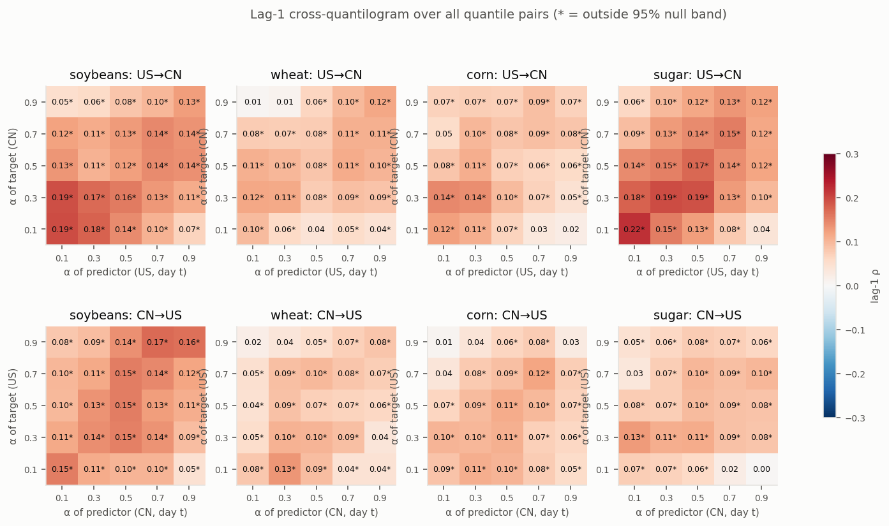
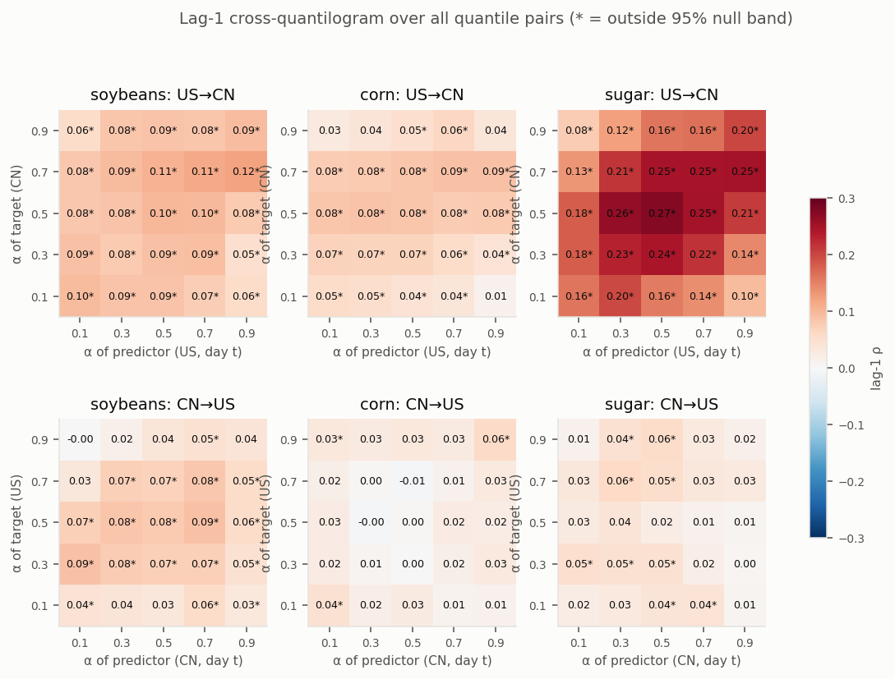

# US ↔ China agricultural futures spillovers: replicating Jiang et al. (2016), and going further

This repo replicates Jiang, Su, Todorova & Roca (2016), *Spillovers and Directional Predictability with a Cross-Quantilogram Analysis: The Case of U.S. and Chinese Agricultural Futures*, Journal of Futures Markets 36(12) ([doi:10.1002/fut.21779](https://doi.org/10.1002/fut.21779)). It then extends the paper in directions the authors didn't take: out-of-sample testing and whether the effect can be traded.

**In one line:** the paper's finding replicates and holds out of sample. As a trade it mostly decayed after 2010. One narrow soybean rule survived until China's night session started in Dec 2014, and a test of the modern equivalent is the main next step.

## At a glance

| | What | Status | Where |
|---|---|---|---|
| **Part 1. Replication** | Re-doing the paper's own analysis: cross-quantilogram, decomposition into overnight and intraday, auto-quantilograms, rolling windows | Done. Matches the published tables (r = 0.97 / 0.81) | [Part 1](#part-1-replication-what-the-paper-did) · [PAPER_NOTES.md](PAPER_NOTES.md) |
| **Part 2. Beyond the paper** | My extensions: test out of sample to 2026, check whether it's tradable, diagnose why the edge decayed, find a surviving rule, pilot the modern market structure | Done on free data | [Part 2](#part-2-beyond-the-paper-my-extensions) · [REPORT.md](REPORT.md) · [STRATEGY.md](STRATEGY.md) |
| **Next steps** | Test the soybean rule in today's market structure, and an ICE vs ZCE sugar pair trade | Not started (needs minute-level data) | [Next steps](#next-steps) · [STRATEGY.md](STRATEGY.md) |

---

## What is a cross-quantilogram?

Ordinary correlation asks: *when the US goes up, does China go up on average?* The cross-quantilogram asks a sharper yes/no question about a specific part of the return distribution:

> *When US soybeans have one of their worst 10% of days, is China more likely to have one of **its** worst 10% of days the next day?*

**How it's built**
1. **Pick a quantile α for each market.** For example, α = 0.1 means the worst 10% of days, 0.5 means below vs above the median, and 0.9 means everything but the best 10% of days.
2. **Turn each return series into a hit/no-hit series:** 1 if that day's return is below the market's α-quantile, 0 otherwise. Subtract α so each series averages about zero.
3. **Correlate China's hits on day *t* with the US hits on day *t − k*.** That correlation is the cross-quantilogram, ρ<sub>α</sub>(k), and it runs from −1 to +1.

$$\hat\rho_\alpha(k)=\frac{\sum_t \psi_{\alpha}\big(r^{CN}_t-\hat q^{CN}\big)\,\psi_{\alpha}\big(r^{US}_{t-k}-\hat q^{US}\big)}{\sqrt{\sum_t \psi_{\alpha}^2\big(r^{CN}_t-\hat q^{CN}\big)}\sqrt{\sum_t \psi_{\alpha}^2\big(r^{US}_{t-k}-\hat q^{US}\big)}},\qquad \psi_\alpha(u)=\mathbf 1[u<0]-\alpha$$

**Reading it**
- **ρ = 0:** knowing the US was in its tail tells you nothing about China's tail *k* days later.
- **ρ > 0:** the tails line up. A bad US day predicts a bad China day.
- **ρ < 0:** they move against each other.

When both markets use the same α, there's a direct translation into probabilities: **P(China hit | US hit) = α + ρ·(1 − α)**. For example, from this replication:
- **Soybeans, α = 0.1, lag 1, ρ ≈ 0.20:** after one of the US's worst-10% days, China has one of *its* worst-10% days **28%** of the time, vs 10% normally.
- **Soybeans, China overnight return, α = 0.5, ρ ≈ 0.35:** after a below-median US day, China *opens* below its median **67%** of the time, vs 50%.

**Why use it instead of correlation**
- **Tails separately:** markets can be linked differently in crashes than on normal days, so you can measure the bottom 10%, the middle and the top 10% one at a time.
- **Direction and timing:** the lag *k* tells you *who leads whom* and for how long.
- **Robust to outliers:** it only uses hit/no-hit, so a single extreme move or a bad data print can't dominate the result the way it can with ordinary correlation.

**Is it significant?** We resample blocks of consecutive days (a "stationary bootstrap", which keeps volatility clustering intact) to see how large ρ gets by pure chance when there's no link. That range is the dashed band in the charts, and a ρ outside it is significant at 5%. A companion portmanteau test (Q) checks lags 1 through 20 jointly. A plain *quantilogram* is the same measure applied to one market against its own past, which is how the paper checks for self-predictability.

*Source: Han, Linton, Oka & Whang (2016), "The cross-quantilogram". Implementation: [`src/quantilogram.py`](src/quantilogram.py).*

---

## Part 1. Replication: what the paper did

**The paper's question:** do US soybean, wheat, corn and sugar futures returns predict Chinese ones (and vice versa), separately for bad, normal and good days? Their sample runs to Aug 2014.

**What I replicated**

| Paper item | What it shows | Replicated? |
|---|---|---|
| Tab III / IV | Samples and descriptive statistics | Yes. Same structure. My sample is shorter (see below). |
| Figs 4–5 | Cross-quantilograms, lags 1–20, US→CN and CN→US | Yes. Same pattern: a significant 1-day effect only, stronger US→CN |
| Figs 6–7 | Auto-quantilograms (self-predictability) | Yes. Also visible: tail clustering at longer lags (volatility clustering), which the paper doesn't discuss |
| **Tab V** | US daily → CN daily / overnight / intraday at lag 1 | Yes. **r = 0.97 with the published values**. CN overnight ≈ 2× daily, CN intraday negative at the median. |
| **Tab VI** | CN daily → US daily / overnight / intraday at lag 1 | Yes. **r = 0.81**, all signs match |
| Figs 8–11 | Rolling 2-year windows | Yes. Same: strongest in the 2008–09 crisis, US→CN most persistent for soybeans and sugar |
| Footnote 9 | All 25 quantile pairs | Yes. Reproduced as a heatmap |

**The paper's conclusion I confirm:** US moves spill into China the next day, mainly through China's *overnight* return (close → next open), and China's daytime session partly reverses that.

**Where my replication differs from the paper**
- **Data:** I used free data (Sina for China, Yahoo for the US) instead of the paper's licensed vendor.
- **Sample start:** 2005 instead of 1999 for soybeans (2003 for wheat and corn).
- **Rolls:** contract rolls are detected and removed instead of the paper's exact roll rule.
- **US open price:** Yahoo's US "open" is the overnight electronic open, not the floor open the paper used. That's the likely reason Table VI fits less well.

### 1.1 The setup: US news reaches China overnight
<picture>
  <source media="(prefers-color-scheme: dark)" srcset="docs/figures/1_timing_dark.png">
  
</picture>

The top row is the paper's setting (its Fig. 3): US futures trade while China is closed, so the US move shows up in China's *next open*. The bottom row is what changed after the paper's sample (see Part 2).

### 1.2 The replication matches the published tables
<picture>
  <source media="(prefers-color-scheme: dark)" srcset="docs/figures/4_replication_dark.png">
  
</picture>

All 72 lag-1 cells from Tables V and VI line up with the published values. Every sign disagreement is on a cell the paper itself reports as ≈0. The paper-sample figures equivalent to its Figs 4–11 are in [`output/figs/paper/`](output/figs/paper) and [`output/figs/rolling/`](output/figs/rolling).

### 1.3 All quantile pairs at once (heatmap)


Each panel is a 5×5 grid. The x-axis is the predictor market's quantile on day *t*, the y-axis is the target market's quantile the next day, and the color is the lag-1 cross-quantilogram (`*` = significant at 5%). The paper mentions running all 25 pairs (its footnote 9) but doesn't show them.
- **Crashes spill over more than rallies.** The strongest US→China cells are in the bottom-left, where both markets are in their lower tails: soybeans 0.19 and sugar 0.22 at 0.1/0.1. That's the downside asymmetry the paper describes.
- **US→China is stronger than China→US,** and wheat and corn are weaker throughout.

---

## Part 2. Beyond the paper: my extensions

The paper stops in 2014 and makes no trading claims. Everything in this part is new.

| Extension | Question | Answer |
|---|---|---|
| 2.1 Out of sample | Does the spillover survive 2014–2026? | **Yes.** It also moved where the timing predicts once China added night sessions. |
| 2.2 Tradability | Can you trade it with daily bars? | The overnight part isn't tradable. The intraday fade had an edge that **went to zero** out of sample. |
| 2.3 Diagnosis | Why did the edge disappear? | China's open **stopped overreacting around 2010**. That's market maturation, not a volatility regime. |
| 2.4 Surviving rule | Does any version still work? | **Soybeans, ≥1σ US moves only**: +7.3%/yr, Sharpe 1.16, 2010–2014 (in-sample) |
| 2.5 Modern pilot | Does it work in today's market structure? | No reversal in an 8-month pilot, but **too little data to conclude** |

### 2.1 Out of sample: the spillover is real, and it moved when China changed its trading hours
<picture>
  <source media="(prefers-color-scheme: dark)" srcset="docs/figures/2_regime_shift_dark.png">
  
</picture>

- **Blue (paper era, replicated):** US day *t* predicts China's overnight return strongly. China's daytime session then partly reverses it.
- **Orange (2014–2026, new):** the daily spillover persists, and in sugar it got stronger. But it moved out of "overnight" into "intraday". Once China's open prints during US hours (night sessions from Dec 2014), that's exactly what the timing predicts. Seeing it in data the authors never had is the strongest evidence the effect is real.

**The same heatmap for 2014–2026:**



- **The downside asymmetry is gone.** Soybeans' US→China link is weaker and roughly even across quantiles (0.05–0.12).
- **Sugar's link got much stronger** and moved to the middle of the distribution (up to 0.27 at the median).
- **China→US has mostly faded:** corn and sugar are near zero, and soybeans are small.
- Wheat is excluded because China's wheat contract has been illiquid since about 2015.

### 2.2 Tradability: an in-sample edge that went to zero
<picture>
  <source media="(prefers-color-scheme: dark)" srcset="docs/figures/3_trade_oos_dark.png">
  
</picture>

You can't trade the overnight spillover: it happens while China is closed. The tradable leg is fading China's *daytime* move after the US close. Corn is the clean out-of-sample test, because it had no night session until 2019. The fade earned 7.9 bp/day (t = 5.2) during the paper's sample, then **≈0 bp/day (t = 0.09)** afterwards. The test has no look-ahead: thresholds come from past data only, and a 1-day-stale signal earns nothing.

### 2.3 Diagnosis: China's open stopped overreacting around 2010
<picture>
  <source media="(prefers-color-scheme: dark)" srcset="docs/figures/5_t1_decay_dark.png">
  
</picture>

- **It decayed around 2010, inside the paper's own sample.** The overreaction shrank by about 60% in every commodity.
- **Volatility doesn't bring it back.** In 2006–09 the reversal lived on volatile days. After 2010, volatile days don't reverse either, which points to market maturation rather than a temporary regime.
- **It's an overreaction to US information specifically.** China's daytime session reverses only the part of its opening jump that the US move explains, which is why fading China's raw gap never worked.

Details are in [REPORT.md](REPORT.md#why-the-tradable-leg-lost-its-edge-scripts07_t1_diagnosispy).

### 2.4 The surviving rule: soybeans, only after a ≥1σ US move (2010–2014)
<picture>
  <source media="(prefers-color-scheme: dark)" srcset="docs/figures/6_soy_equity_dark.png">
  
</picture>

**Rule A:** when CBOT soybeans close up or down at least 1σ (trailing 60-day vol), take the *opposite* side in DCE soybeans at the next open, and exit at that day's close. Otherwise stay flat.

| 2010 → Dec 2014 | Per year | Sharpe | Max drawdown |
|---|---|---|---|
| **Rule A** (after costs) | **+7.3%** | **1.16** | −8.0% |
| Same fade, every day (after costs) | −0.3% | −0.03 | −40.9% |
| Buy & hold DCE soybeans (no costs) | +1.8% | 0.13 | −15.1% |

- **Why these rules:** China's open overreacts to the US move, and only on big moves is the reversal larger than costs. Soybeans decayed least of the four commodities.
- **Caveats:** it's in-sample (the rule and the 2010 start were chosen after seeing this period), most of the return comes from 2012 and 2014, and it can't be run as built after the Dec 2014 night session.

Full rules, the reasoning behind each, rejected variants and benchmark definitions are in **[STRATEGY.md](STRATEGY.md)**.

### 2.5 Modern-structure pilot (09:00 Beijing open)
Since Dec 2014, the first Chinese price after the US close is the **09:00 day-session open**. I ran a pilot on free intraday data (5 commodity pairs, Mar–Nov 2026, 819 days).
- China's open *does* absorb the late US move.
- There's **no reversal**: pooled slope +0.02 ± 0.08.
- For soybeans, Rule A's modern version lost money on 38 trades.

That's too small a sample to conclude anything.

---

## Next steps

Everything in Part 2 used free data, and two questions can't be answered without minute-level history. These are the next steps, none of which has been started.

### Data needed
| Data | What it unlocks | Possible sources |
|---|---|---|
| Chinese 1-minute (or tick) bars, 2010 → now: DCE soybeans, soymeal, soyoil, corn; ZCE sugar. Including the opening auction and the night session. | The 09:00-open version of Rule A, clean entry prices, and the sugar lead-lag test. **This is the binding constraint:** free sources keep only about 8 months. | Wind, TqSdk, JoinQuant, RiceQuant, Tushare Pro |
| CBOT 1-minute bars, 2010 → now (ZS, ZM, ZL, ZC) | The exact US move after China's night close | Databento |
| ICE sugar #11 1-minute bars, and USD/CNH 1-minute | The sugar pair-trade spread | ICE data or a vendor; an FX data vendor |
| Chinese order-book data at the open and close | Realistic fills, slippage and capacity | Tick-level vendor data |

### 1. Does the soybean rule still work today?
The question is whether Rule A, or its opposite, works now that China's first price after the US close is the 09:00 day-session open.
1. **Pre-register.** Freeze the rule, the main metric and the pass/fail criteria in a commit *before* touching new data. Pass means:
   - net bp/trade above 0 with t above 2 from 2015 onward,
   - positive in at least 60% of years,
   - still positive at double the assumed costs.
2. **Re-run 2010–14 on clean intraday data.** If the +11 bp/trade disappears with clean opening prices, it was an artifact of the free data, and the work stops there.
3. **Test the modern version.** Signal: the US move after China's night close. Trade: the 09:00 → 15:00 session. First look at the minute-by-minute response after the open, then decide whether to exit early.
4. **Robustness.** Vary the threshold (0.75–1.5σ), the volatility window (20/60/120 days) and the entry/exit timing. Results should form a plateau, not a spike.
5. **Other markets.** Repeat on soymeal, soyoil, corn and sugar.
6. **Adjust the statistics for every variant tried:** White's Reality Check or Hansen's SPA, and a deflated Sharpe ratio.
7. **Walk-forward.** Refit only the threshold once a year, using past data only.
8. **Execution.** Model auction fills, limit-up/limit-down days (when you can't trade), fees, and capacity relative to opening volume.
9. **Paper trade forward for 6–12 months** with a daily data collector, and compare the results with the backtest.
10. **Set kill criteria before going live:** stop if the rolling 250-trade t-stat drops below 0.

**What would change my mind:**
- **Pursue it:** clean data confirms 2010–14, *and* the 09:00-open version shows a reversal with t < −2 across the soy complex.
- **Drop it:** either one fails. The US → China spillover would then be information, not a trade.

### 2. ICE vs ZCE sugar pair trade
The 2014–2026 sugar heatmap is dark mostly because the two markets now trade the same news *at the same time*: ZCE's night session (13:00–15:00 UTC) overlaps ICE's trading hours. A pilot on free hourly data (Mar–Nov 2026, 162 nights, [`scripts/09_sugar_overlap_pilot.py`](scripts/09_sugar_overlap_pilot.py)) found:
- ZCE prices in ICE's move **instantly** at its night open (t 6.0).
- The two **move together** during the overlap (t 5.7).
- There's **no drift afterwards.** Carrying the ICE move into China failed: 29 trades, −3.9 bp before costs.
- ICE leads and China follows; there's no effect from China to the US.

If ZCE lags ICE by even a few minutes, the spread between them should briefly widen and then close. Trading it back toward normal could be a strategy.

**Next steps for this idea**
1. **Check access first.** Confirm whether a foreign account can trade ZCE sugar, and through which channel. If it can't, the idea is only research, so decide that before buying any data.
2. **Get the data.** ZCE sugar 1-minute or tick bars, ICE sugar #11 1-minute bars, and USD/CNH 1-minute bars, from December 2014 onward (when ZCE sugar's night session began).
3. **Pre-register.** Before looking at the new data, commit the test, the main metric and pass/fail criteria. Pass means:
   - net profit per trade above 0 with t above 2,
   - positive in at least 60% of years,
   - still positive at double the assumed costs.
4. **Measure the lead-lag.** During the 13:00–15:00 UTC overlap, compute the cross-correlation and this repo's cross-quantilogram at 1-, 2-, 5- and 10-minute lags. Does ICE lead ZCE, and by how many minutes? If the lead is under a minute, stop: it's a speed race 1-minute data can't capture.
5. **Build the spread.** Convert ICE (US cents/lb) to RMB/tonne with USD/CNH, estimate a rolling hedge ratio within the overlap, and measure how quickly gaps close (the half-life). Only a spread that closes within the 2-hour window is tradable.
6. **Backtest after costs.** Enter when the spread is unusually wide, exit when it normalizes or at the end of the overlap. Count both legs, the FX conversion and slippage. No positions are carried outside the overlap.
7. **Robustness.** Vary the entry threshold, the hedge-ratio window and the lag. Results should form a plateau, not a spike. Split the results by year and by volatility regime.
8. **A one-leg version.** If trading both legs isn't practical, test trading ZCE alone in the direction ICE implies. That's the same signal with half the cost.
9. **Paper trade forward** for 3–6 months during the overlap before any capital.

**What would change my mind**
- **Pursue it:** ICE leads ZCE by at least a few minutes, the spread closes within the overlap, and the after-cost backtest passes the pre-registered criteria.
- **Drop it:** the lead is under a minute, the spread doesn't close within the window, or ZCE isn't accessible. In that case the sugar link is useful for **hedging** (ICE as a proxy for ZCE exposure) but not as a trade.

**Hurdles**
- **Different products.** ICE #11 is raw cane sugar and ZCE is white sugar, separated by refining margins and China's import tariffs. The spread can drift for months, so only short-term convergence is a candidate.
- **The window is short:** about 2 hours a day.
- **Access.** Foreign participation in Chinese commodity futures is restricted (see step 1).
- **Speed.** If ZCE catches up within seconds, it's a latency race that 1-minute data can't capture.

More detail is in [STRATEGY.md](STRATEGY.md#next-steps-how-wed-check-whether-this-still-works).

---

## How it was validated
1. **Engine:** the hand-computed statistic matches, a planted signal is detected, and the false-positive rate on independent series is ~6–8% at nominal 5% (slightly hot, documented).
2. **Timing alignment:** verified on synthetic index data.
3. **Data cleaning:** contract rolls and bad prints are removed. No Chinese daily return exceeds the exchange price limit.
4. **Replication:** all 72 published cells compared (chart 1.2).
5. **Look-ahead audit:** a stale signal kills the edge.
6. **Out of sample:** 2014–2026, including the night-session regime change.

## Documents
- **[PAPER_NOTES.md](PAPER_NOTES.md):** the paper page by page, its method and data, and every target number (Part 1).
- **[REPORT.md](REPORT.md):** full results for the replication, out-of-sample tests, trade tests and diagnosis (Parts 1–2).
- **[STRATEGY.md](STRATEGY.md):** the trading rules and why, benchmarks, and the validation plan for next steps (Part 2.4).
- **`output/`:** all figures and CSV tables.

## Run
```bash
pip install -r requirements.txt
python tests/test_quantilogram.py
# Part 1: replication
python scripts/01_fetch.py                    # caches data to data/raw/
python scripts/02_replicate.py                # paper sample, about 3 min at B=1000
python scripts/03_rolling.py                  # rolling windows (paper era + extension to 2026)
# Part 2: extensions
python scripts/02_replicate.py --start 2014-09-01 --end "" --tag oos --commodities soybeans,corn,sugar --min_cn_volume 2000
python scripts/05_trade.py                    # tradability tests
python scripts/07_t1_diagnosis.py             # why the fade decayed + 09:00-open pilot (chart 2.3)
python scripts/08_soy_equity.py               # soybean Rule A vs benchmarks, 2010-2014 (chart 2.4)
python scripts/09_sugar_overlap_pilot.py      # ICE vs ZCE sugar night-session pilot (pair-trade idea)
python scripts/06_readme_figures.py           # regenerates charts 1.1, 1.2, 2.1, 2.2
```
`src/quantilogram.py` is a standalone numba implementation of the cross-quantilogram and portmanteau test (Han, Linton, Oka & Whang), with stationary-bootstrap inference.

*The paper PDF and raw vendor data aren't included (copyright and licensing). The scripts re-fetch the data.*
