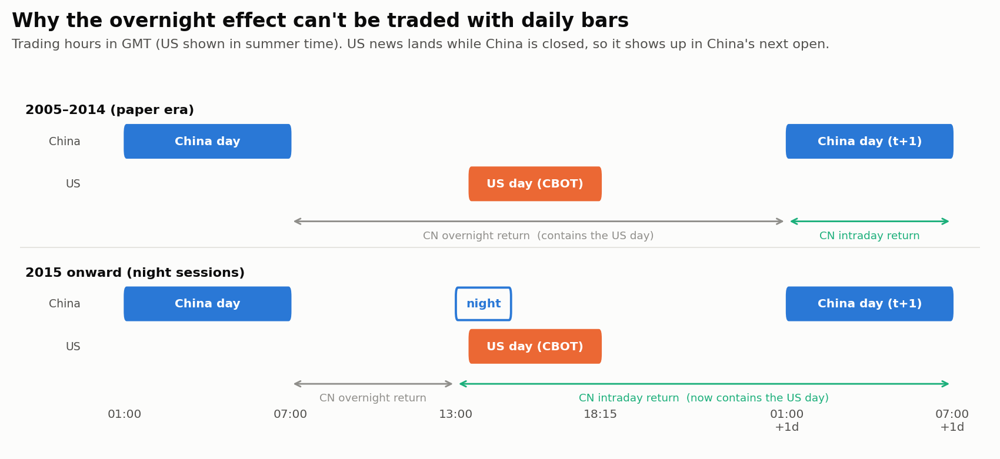
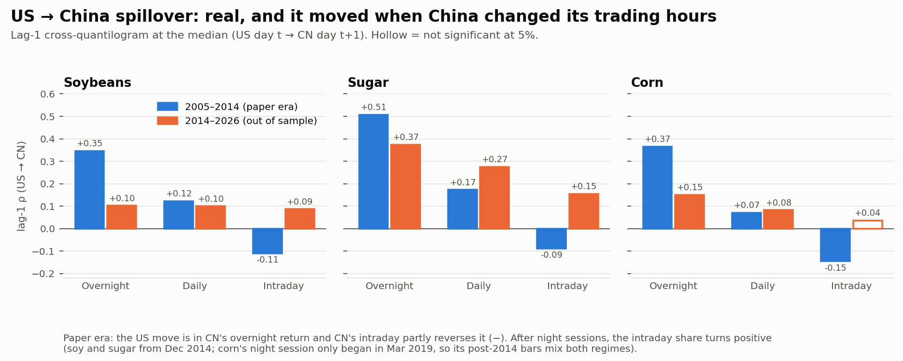
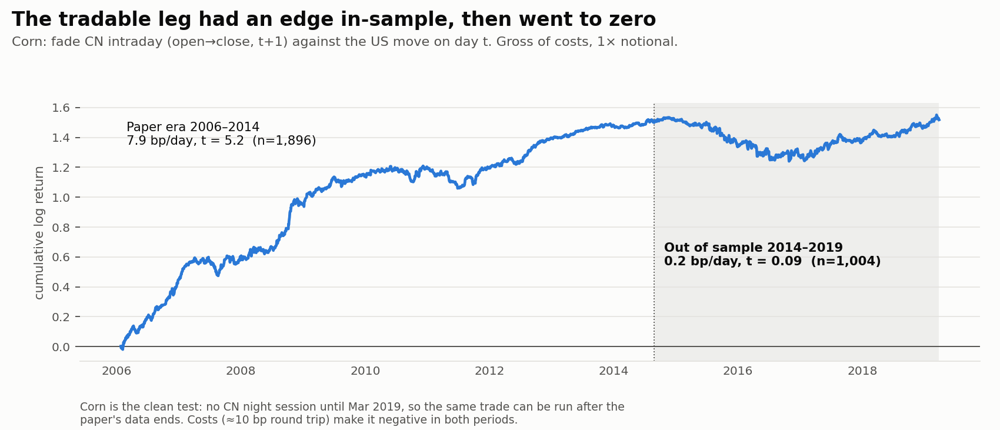
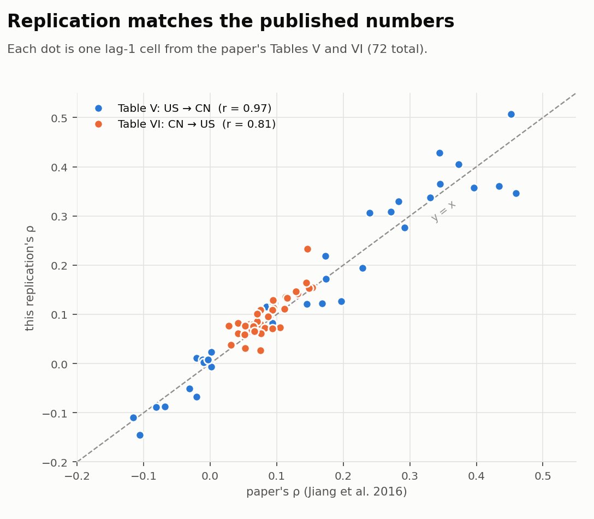
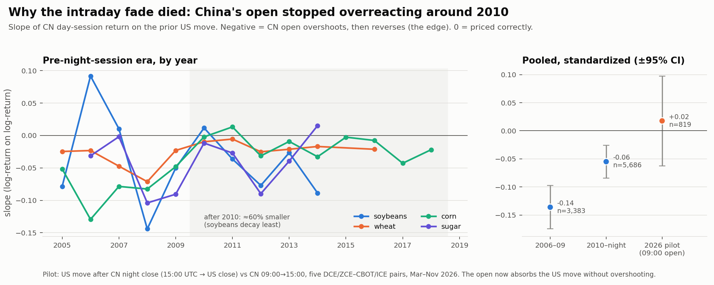
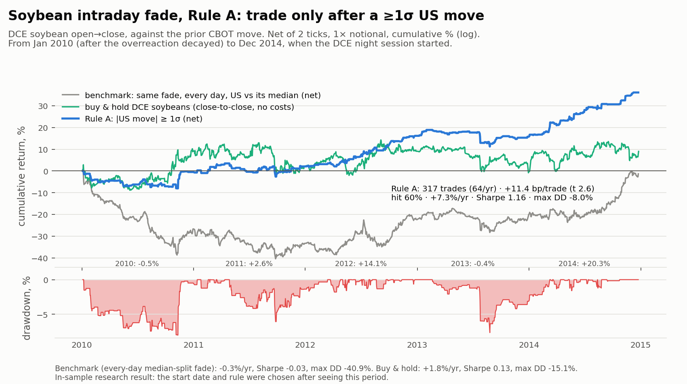

# US ↔ China agricultural futures spillovers: replicating Jiang et al. (2016)

This repo replicates the results and tests the tradability of Jiang, Su, Todorova & Roca (2016), *Spillovers and Directional Predictability with a Cross-Quantilogram Analysis: The Case of U.S. and Chinese Agricultural Futures*, Journal of Futures Markets 36(12) ([doi:10.1002/fut.21779](https://doi.org/10.1002/fut.21779)).

**In one line:** the paper's finding replicates and holds up on 2014–2026 data. As a trade on daily bars, it doesn't work.

---

### 1. The setup: US news reaches China overnight
<picture>
  <source media="(prefers-color-scheme: dark)" srcset="docs/figures/1_timing_dark.png">
  
</picture>

US futures trade while China is closed, so the US move shows up in China's *next open*. You can't trade China at the moment the US move happens. Since Dec 2014, China's night session opens during US trading hours, which moves where the US information lands.

### 2. The finding: moved when China changed its trading hours
<picture>
  <source media="(prefers-color-scheme: dark)" srcset="docs/figures/2_regime_shift_dark.png">
  
</picture>

- **Paper era (blue):** US day *t* predicts China's overnight return strongly (ρ ≈ 0.35–0.51). China's daytime session then partly reverses it (negative intraday ρ).
- **After 2014 (orange):** the daily spillover persists, and in sugar it got stronger. But it moved out of "overnight" into "intraday". Once China's open prints during US hours, that's exactly what the timing predicts. Seeing it in data the authors never had is the strongest evidence the effect is real.

### 3. The trade: an in-sample edge that went to zero
<picture>
  <source media="(prefers-color-scheme: dark)" srcset="docs/figures/3_trade_oos_dark.png">
  
</picture>

The tradable leg is fading China's daytime move after the US close. It earned 7.9 bp/day (t = 5.2) during the paper's sample, then **≈0 bp/day (t = 0.09)** afterwards. The test has no look-ahead: thresholds come from past data only, and a 1-day-stale signal earns nothing. After about 10 bp of round-trip costs it loses money in both periods.

### 4. The replication matches the published tables
<picture>
  <source media="(prefers-color-scheme: dark)" srcset="docs/figures/4_replication_dark.png">
  
</picture>

These numbers come from different data (free Sina and Yahoo series vs the paper's licensed vendor) and a shorter sample, yet all 72 lag-1 cells line up with the published values. Table V correlates at 0.97 and Table VI at 0.81. Every sign disagreement is on a cell the paper itself reports as ≈0. The weaker Table VI fit is most likely because Yahoo's "open" is the overnight electronic open, not the floor open the paper used.

### 5. Why it died: China's open stopped overreacting around 2010
<picture>
  <source media="(prefers-color-scheme: dark)" srcset="docs/figures/5_t1_decay_dark.png">
  
</picture>

The overreaction shrank by about 60% after 2010, in every commodity, and volatile markets didn't bring it back. That points to the market maturing, not a temporary regime. Trading only on US moves of at least 1σ still worked for soybeans through 2014 (about +11 bp/trade net). But soybeans now have a night session, and a 2026 pilot at today's equivalent entry, the 09:00 Beijing open, shows no reversal. Details are in [REPORT.md](REPORT.md#why-the-tradable-leg-lost-its-edge-scripts07_t1_diagnosispy).

### 6. The surviving rule: soybeans, only after a ≥1σ US move (2010–2014)
<picture>
  <source media="(prefers-color-scheme: dark)" srcset="docs/figures/6_soy_equity_dark.png">
  
</picture>

**Rule A:** when CBOT soybeans close up or down at least 1σ (trailing 60-day vol), take the *opposite* side in DCE soybeans at the next open, and exit at that day's close. Otherwise stay flat.
- **2010 to Dec 2014:** 317 trades, +11.4 bp/trade net (t 2.6), +7.3%/yr, Sharpe 1.16, max drawdown −8%. The benchmark, the same fade traded every day (short DCE after an above-median US day, long after a below-median one), made −0.3%/yr with a −41% drawdown. Passively buying DCE's open and selling its close made −9.4%/yr after costs, and buy-and-hold of DCE soybeans made +1.8%/yr (Sharpe 0.13, −15% drawdown).
- **Why these rules:** China's open overreacts to the US move, and only on big moves is the reversal larger than costs. Soybeans decayed least of the four commodities.
- **Caveats:** this is in-sample, most of the return comes from 2012 and 2014, and it can't be run as built after the Dec 2014 night session.

**[STRATEGY.md](STRATEGY.md)** has the full rules, the reasoning behind each one, what was rejected, and how we'd test whether it still works with more data.

---

## More detail
- **[STRATEGY.md](STRATEGY.md)** has the trading rules and their rationale, plus the validation plan for more data.
- **[REPORT.md](REPORT.md)** has full results, trade statistics, data caveats, and the one hypothesis still worth testing.
- **[PAPER_NOTES.md](PAPER_NOTES.md)** has the page-by-page summary of the paper, its method, its data, and every target number.
- **`output/`** has all the replication figures (the paper's Figs 4–11 equivalents) and the CSV tables.

## How it was validated
1. **Engine:** the hand-computed statistic matches, a planted signal is detected, and the false-positive rate on independent series is ~6–8% at nominal 5% (slightly hot, documented).
2. **Timing alignment:** verified on synthetic index data.
3. **Data cleaning:** contract rolls and bad prints are removed. No Chinese daily return exceeds the exchange price limit.
4. **Replication:** all 72 published cells compared, as in chart 4.
5. **Look-ahead audit:** a stale signal kills the edge.
6. **Out of sample:** 2014–2026, including the night-session regime change.

## Run
```bash
pip install -r requirements.txt
python tests/test_quantilogram.py
python scripts/01_fetch.py                    # caches data to data/raw/
python scripts/02_replicate.py                # paper sample, about 3 min at B=1000
python scripts/02_replicate.py --start 2014-09-01 --end "" --tag oos --commodities soybeans,corn,sugar --min_cn_volume 2000
python scripts/03_rolling.py
python scripts/05_trade.py
python scripts/06_readme_figures.py           # regenerates charts 1-4
python scripts/07_t1_diagnosis.py             # why the fade decayed + modern 09:00-open pilot (chart 5)
python scripts/08_soy_equity.py               # soybean Rule A equity curve, 2010-2014 (chart 6)
```
`src/quantilogram.py` is a standalone numba implementation of the cross-quantilogram and portmanteau test (Han, Linton, Oka & Whang), with stationary-bootstrap inference.

*The paper PDF and raw vendor data aren't included (copyright and licensing). The scripts re-fetch the data.*
