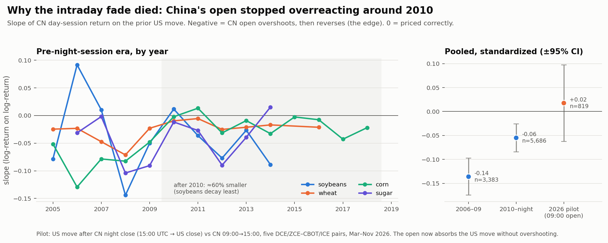

# Replicating Jiang et al. (2016): US↔China ag-futures spillovers via the cross-quantilogram

The page-by-page summary, the method and the paper's target numbers are in `PAPER_NOTES.md`. Everything below can be regenerated with `scripts/01–05`.

## TL;DR
1. **The replication works.** On free data (Sina main-continuous plus yfinance), Table V matches the paper with **correlation 0.97, MAE 0.032, sign agreement 86%, significance agreement 94%**. Table VI matches with **correlation 0.81, MAE 0.021, sign agreement 100%, significance agreement 83%**. Every sign disagreement is a cell the paper itself reports as ≈0 and insignificant. Every significance disagreement is borderline, mostly at α=0.9.
2. **The paper's core result is real.** The US→CN spillover is a 1-day effect that sits almost entirely in the CN overnight return (soy OV ρ≈0.35 vs daily ≈0.15), and CN intraday shows a significant **reversal** at the median (ρ≈−0.09 to −0.15).
3. **The overnight effect isn't tradable.** US day *t* happens while China is closed (before Dec 2014), so you can't trade CN at the moment the US information appears.
4. **The tradable leg, fading CN intraday after the US move, had an edge in-sample and doesn't hold out of sample.** In 2006–2014 the gross edge was 5–9 bp/day with Newey-West t of 3–5 in all four commodities, and a 1-day-stale signal falls to ≈0, so there's no look-ahead. After 2 ticks of costs, only soy and sugar tails survived (+15 and +13 bp/trade, t 3.0 and 2.1), and mostly in 2008–09. The one clean out-of-sample test, **corn from Sep 2014 to Mar 2019 (before its night session), gives 0.1 bp gross, t=0.05.** CN's own median lag-1 auto-quantilogram also shrinks after 2014: soy goes from −0.15 to +0.01, sugar from −0.06 to −0.01, and corn from −0.08 to −0.04 (corn is still significant).
5. **The microstructure prediction holds out of sample.** Once CN night sessions began (Dec 2014 for soy and sugar), the CN "open" prints during the US session. US information should then shift from the OV leg into the IN leg, and it does: **soy IN flips from −0.11 to +0.09, sugar IN from −0.09 to +0.15, soy OV falls from 0.35 to 0.10.** The daily US→CN spillover persists, strongly for sugar (ρ 0.27 at the median, significant in 83% of rolling windows). CN→US has largely died (sugar ≈0.02, corn ≈0.03).

**Verdict:** this is a good replication of a statistical fact. As a trading strategy on daily bars it's dead. The only live hypothesis left needs intraday CN data (below).

## What was built
| File | Purpose |
|---|---|
| `src/quantilogram.py` | Numba cross-quantilogram (Eq 2), portmanteau Q (Eq 3), stationary bootstrap of lagged pairs (block length from Patton-Politis-White, quantiles re-estimated in each resample, null band centered on ρ̂). About 3 min for the full paper run at B=1000. |
| `src/data.py` | Sina CN main-continuous and yfinance US data, cached as parquet. Roll and flap detection (OI jumps, moves beyond the price limit, next-day reversals). Bad-open removal. Night-session dates. |
| `src/align.py` | The paper's Fig 3 timing: US_t→CN_{t+1}; CN_t→US_t. Verified with synthetic indices. |
| `tests/test_quantilogram.py` | Hand-computed ρ, power against a planted tail effect, size under the null. |
| `scripts/02_replicate.py` | Tabs III/IV, Figs 4–7, Tabs V/VI, footnote-9 α-grid heatmap. `--tag oos` for 2014→2026. |
| `scripts/03_rolling.py` | Figs 8–11 extended to 2026. |
| `scripts/05_trade.py` | T1 / T1g backtests, look-ahead audit, OLS attribution. |

## Lag-1 ρ, paper era (2005–2014-08) vs out of sample (2014-09→2026), α=0.5
| | Paper | Mine (paper era) | OOS 2014–26 |
|---|---|---|---|
| Soy US→CN daily | .168* | .122* | .100* |
| Soy US→CN overnight | .459* | .346* | .101* |
| Soy US→CN intraday | **−.116*** | **−.110*** | **+.086*** |
| Sugar US→CN daily | .174* | .173* | .274* |
| Sugar US→CN intraday | −.068* | −.088* | +.154* |
| Corn US→CN intraday | −.106* | −.145* | +.036 |
| Soy CN→US daily | .149* | .153* | .079* |
| Sugar CN→US daily | .087* | .096* | .023 |

\* = outside the 95% stationary-bootstrap null band.

## Trade test T1: fade CN intraday (open t+1 → close t+1) against the US move on day t
Signal thresholds come from the expanding past distribution of US returns, so there's no full-sample look-ahead. Net figures subtract 2 ticks round trip.

| | gross bp/trade (t) | net bp/trade (t) | Notes |
|---|---|---|---|
| Soy, median split, 2006–14 | 9.2 (4.3) | 4.1 (2.0) | |
| Soy, tails only, 2006–14 | 21.1 (4.0) | **15.3 (3.0)** | Profit concentrated in 2008–09 |
| Sugar, tails only, 2007–14 | 17.2 (2.8) | **12.6 (2.1)** | Profit concentrated in 2008–09 |
| Corn, median split, 2006–14 | 7.9 (5.2) | −2.7 | Tick = 5 bp, so costs dominate |
| **Corn, median split, 2014-09→2019-03 (OOS)** | **0.1 (0.05)** | −10.9 | **Edge gone** |
| Audit: signal 1 day stale (all commodities) | −0.6 to 1.8 (≤1.1) | | Confirms no look-ahead |
| T1g, fade CN's own opening gap, post-night | −1 to +2 (n.s.) | negative | |

An OLS of CN_IN(t+1) on US_D(t) and the CN gap shows the US return carries reversal information beyond CN's own gap (t ≈ −2.9 to −4.3).

## Data caveats (honest list)
- **CN:** Sina main-continuous starts in 2005, so the soy sample is 2,270 days vs the paper's 3,566 (1999+). I couldn't apply the paper's roll rule, because DCE blocks scraping (HTTP 412) and expired contracts aren't served. Detected roll days (2–6% of days) have D and OV voided.
- **US:** yfinance `Open` is the 19:00 CT electronic open, not the 2014-era floor open. This is the most likely reason Table VI matches less well than Table V (correlation 0.81 vs 0.97).
- **Wheat:** ZCE strong wheat is illiquid after 2015 (median volume below 2k lots), so it's excluded from out-of-sample.
- **Bootstrap size:** the test runs slightly hot, rejecting 6–8% of the time at nominal 5% in Monte Carlo at n=2000. Treat cells near the band edge as borderline.
- **Tail auto-quantilograms (α=.1/.9):** significant at about 25% of lags 2–20. That's volatility clustering. The paper's Figs 6–7 show it too but the text doesn't discuss it.

## The one hypothesis still worth testing
In the night-session era, the CN contract that trades **after** the US close is the **09:00 Beijing day-session open** (01:00 UTC). The test: does US_t (or the CN night-session move) predict CN 09:00→15:00, and does the old overreaction reversal survive there? Daily bars can't answer this. Sina's free intraday history covers only about 8 months. That would need either paid CN 1-min data (Wind, TqSdk, JoinQuant, ~2015+) or CN 60-min bars collected forward. The CN→US leg (T2) similarly needs the CBOT 8:30 CT open: Databento GLBX.MDP3 1h bars, 2010+. But CN→US has decayed to ≈0.03–0.05, so it's low priority.

## Why the tradable leg lost its edge (`scripts/07_t1_diagnosis.py`)

**1. It decayed around 2010, not 2014.** Corn's out-of-sample failure was the tail end of a decline that started inside the paper's own sample. Pooled reversal slopes, using each commodity's years before its night session:

| | 2006–09 | 2010 → night session | Decay |
|---|---|---|---|
| Corn | −0.078 (t −6.3) | −0.014 (t −1.8) | −82% |
| Wheat | −0.051 (t −3.8) | −0.017 (t −2.0) | −67% |
| Sugar | −0.070 (t −4.1) | −0.028 (t −2.3) | −60% |
| Soybeans | −0.076 (t −3.4) | −0.048 (t −3.4) | −37% |

**2. It's maturation, not a volatility regime.**
- In 2006–09 the reversal lived on high-US-volatility days (pooled slope −0.16, t −6.6) and was absent on low-volatility days.
- After 2010, high-volatility days *don't* reverse (t −1.2), so a volatility filter wouldn't bring the edge back.
- The 2008–09 crisis contributed a disproportionate share.
- Corn also had a policy-specific factor: the state reserve program pinned prices near 2,370 RMB in 2011–15, when CN daytime volatility fell to about 30 bp.

**3. The reversal is an overreaction to US information, not noise at the open.** China's daytime return loads on the part of the opening gap that the US move explains (−0.39 in 2006–09, −0.21 after). The rest of the gap doesn't reverse (≈0). So fading the raw gap (T1g) was the wrong signal: it mixes the real effect with auction noise.

**4. The payoff scales with the size of the US move.** That motivated three rules, with designs fixed from the mechanism. Results are net of 2 ticks:

| Net bp/trade (t) | Soybeans | Sugar | Corn | Wheat |
|---|---|---|---|---|
| Base (median split), 2010 → night | −0.1 (−0.1) | 0.2 (0.1) | −8.1 (−6.3) | −2.8 (−1.7) |
| **A: trade only if US move ≥ 1σ**, 2006–09 | 12.2 (1.6) | 18.2 (2.8) | 14.4 (3.0) | 1.8 (0.3) |
| **A: trade only if US move ≥ 1σ**, 2010 → night | **11.4 (2.6)** | 4.2 (0.8) | −5.6 (−2.1) | −3.7 (−1.1) |

- Rule A rescues **soybeans**, with stable results in both eras (about 60 trades a year). It doesn't rescue the others.
- Rule B (sizing by the US move) is the most consistent gross, but too thin net of costs.
- Rule C (A plus an adaptive "is the anomaly alive" switch) adds nothing over A.
- *Caveat:* the post-2010 data was looked at during this diagnosis, so these results are contaminated. Judge them by consistency, not by the best cell.

**5. This legacy trade can't be run today.** Soybeans have had a night session since Dec 2014 (corn since 2019). The modern equivalent is the **09:00 Beijing day-session open**, the first CN price after the US close.
- **Pilot (5 pairs: A/ZS, M/ZM, Y/ZL, C/ZC, SR/SB; Mar–Nov 2026; 819 obs):** the US move after the CN night close (15:00 UTC → US close) *is* priced in at 09:00, with pass-through significant in all 5 pairs. But there's **no reversal**: pooled standardized slope +0.02 ± 0.08. That rules out the 2006–09 effect size (−0.14) but not the post-2010 size (−0.06).
- *Verdict:* no tradable fade in today's structure on current evidence. The pilot has low power, so the honest next step is to collect CN 60-min bars going forward (Sina only serves about 8 months) or buy history, then retest at n ≈ 2,000.
