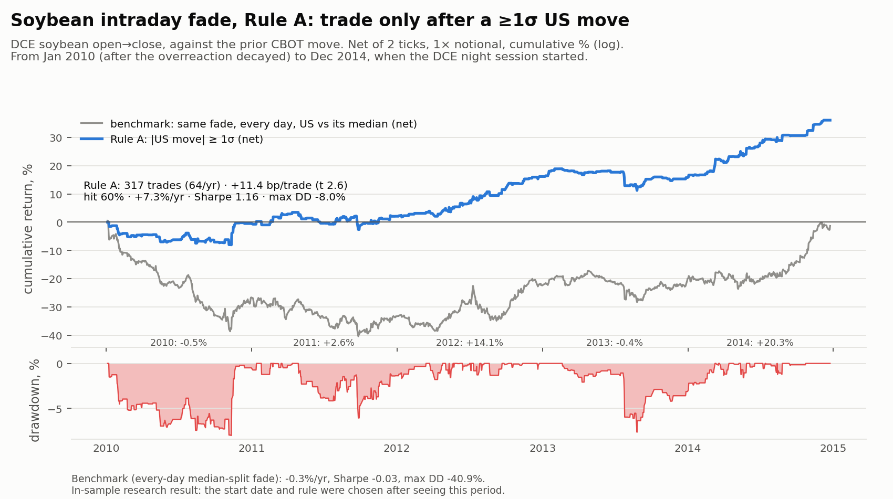

# Strategy: soybean intraday fade after large US moves

This document covers the exact trading rules, why each one was chosen, what the backtest shows, and how we'd find out whether it still works if we had more data.

> **Status:** research result, in-sample. The rule and the 2010 start date were chosen after looking at the 2010–2014 data. It hasn't been tested on data we haven't already seen, and it can't be run in today's market structure without intraday data (see [Next steps](#next-steps-how-wed-check-whether-this-still-works)).



## 1. The trading rules (Rule A)

| | Rule |
|---|---|
| **Instrument traded** | DCE soybean No.1 (`A`), the most-traded contract |
| **Signal instrument** | CBOT soybeans (`ZS`), front contract |
| **Signal** | z = CBOT soybean close-to-close log return on day *t* ÷ its trailing 60-day standard deviation (through day *t−1*, at least 40 observations) |
| **When the signal is known** | After the CBOT close on day *t* (≈18:20–19:20 UTC), about 6 hours before the DCE open at 09:00 Beijing (01:00 UTC) |
| **Entry** | If \|z\| ≥ 1: take position **−sign(z)** (short DCE after a big US up-move, long after a big US down-move) at the DCE open on day *t+1*. Otherwise stay flat. |
| **Exit** | DCE close (15:00 Beijing) the same day. No overnight risk. |
| **Size** | 1× notional per trade, no compounding, no leverage |
| **Costs assumed** | 2 ticks round trip (1 RMB/t tick ≈ 2.5 bp per side at ~4,000 RMB/t) |
| **Valid period** | Jan 2010 → 25 Dec 2014. On 26 Dec 2014 the DCE soybean night session started, so the daily "open" now prints during US hours. |

## 2. Why each rule

Every choice traces back to something measured in the diagnosis (`scripts/07_t1_diagnosis.py`, `REPORT.md`).

| Choice | Why | Evidence |
|---|---|---|
| **Fade** the US move (trade against it) | China's open over-absorbs the US move, and the day session partly reverses it. This is the paper's negative intraday cross-quantilogram. | Paper Tab V: intraday ρ −0.116 for soy at the median. Our replication: −0.110. |
| **Signal on the US move, not China's own opening gap** | The day-session reversal loads only on the part of the gap the US move explains. The rest of the gap (auction noise) doesn't reverse, so a gap-based signal is diluted by noise. | US-explained gap: −0.39 (t −7.0) in 2006–09, −0.21 (t −3.7) after 2010. Residual gap: −0.07 / −0.02, not significant. |
| **Trade only when \|z\| ≥ 1** | The payoff grows with the size of the US move, while costs are the same on every trade. Skipping small-move days cuts about 75% of trades and most of the cost drag. 1σ is a round threshold set from that mechanism; it wasn't grid-searched. | After 2010, fade payoff by US-move size: 0.03 (\|z\|<1), 0.09 (1–2σ), 0.10 (≥2σ) CN-vol units. |
| **Volatility-normalize the signal** | Keeps "a big move" comparable across calm and volatile regimes. It's backward-looking only. | Trailing 60-day vol, lagged one day |
| **Hold open → close** | That's where the reversal lives (the paper's "intraday" component), and flattening at the close avoids carrying risk overnight. | — |
| **Soybeans only** | Soybeans decayed least after 2010. Corn and wheat have about a 5 bp tick and a smaller remaining effect, so costs wipe them out. Sugar stays positive but isn't significant. | Reversal decay after 2010: soy −37%, sugar −60%, wheat −67%, corn −82%. After-2010 net: corn −5.6 bp, wheat −3.7 bp, sugar +4.2 bp (t 0.8). |
| **Start Jan 2010** | 2006–09 was a different regime: a larger, crisis-driven overreaction that has since decayed. Starting in 2010 tests whether the rule survives in the more mature market. | Yearly reversal slopes drop sharply in 2010 for all four commodities (README chart 5). |

**Considered and rejected:**
- **Trade every day** (the median-split benchmark above): no net edge after 2010 (−0.1 bp, t −0.05) and a −41% drawdown.
- **Size in proportion to z:** the most consistent gross result, but too thin after costs (+1.7 bp, t 1.6).
- **An adaptive "anomaly alive" switch** (trailing reversal t-stat < −1): no improvement over Rule A.
- **Fade China's raw opening gap:** dominated by auction noise, and negative after costs.

## 3. Results, Jan 2010 → Dec 2014 (net of 2 ticks)

### Benchmarks: what "trade every day" means
Every strategy here uses the same execution: enter at the DCE open on day *t+1*, exit at the close, 1× notional, 2 ticks round trip. The benchmarks differ only in *when* and *which way* they trade:

| | Definition | Question it answers |
|---|---|---|
| **Rule A** | Fade the US move only when \|z\| ≥ 1, otherwise flat (about 27% of days) | — |
| **Benchmark: every-day median-split fade** (*"trade every day"*) | **Every** trading day: short DCE if the CBOT soybean return on day *t* was above its historical median (expanding window, ≥250 days), long if below. Always in the market. | Does the 1σ filter add value? This is the paper's median-quantile (α = 0.5) finding traded directly, with the same direction and execution as Rule A. The only difference is the filter. |
| **Passive: long open → close every day** | Buy DCE soybeans at every open, sell at the close, ignoring the US entirely | Is Rule A just picking up an intraday drift in DCE soybeans? |
| **Buy & hold DCE soybeans** | Hold the main contract every day, close to close (roll days set to 0, no costs) | Does an active strategy beat simply owning the underlying? Note that this carries overnight risk, which the intraday strategies don't. |
| **Cash** | No position | The zero line. Every strategy has to beat it after costs. |

### Results
| | Rule A | Every-day median-split fade | Passive long open→close | Buy & hold DCE soybeans |
|---|---|---|---|---|
| Days in the market | 317 (64/yr) | 1,162 (all) | 1,162 (all) | 1,203 (all, incl. overnight) |
| Per trade / day | **+11.4 bp** (t 2.6) | −0.1 bp | −4.0 bp | +0.75 bp/day (t 0.3) |
| Hit rate | 60% | 52% | — | 51% of days up |
| Return / yr | **+7.3%** | −0.3% | −9.4% (+1.2% before costs) | +1.8% (no costs) |
| Sharpe | **1.16** | −0.03 | −0.89 | 0.13 |
| Max drawdown | −8.0% | −40.9% | −51.9% | −15.1% |

**Reading it:**
- The direction signal alone (the every-day fade) has no net edge after 2010, so all of Rule A's value comes from *which days* it trades.
- There's no meaningful intraday drift to explain the result: the passive long earns +1.2%/yr before costs and loses money after.
- **Simply owning the underlying** made +1.8%/yr (Sharpe 0.13) with a −15% drawdown. Soybeans went roughly sideways over 2010–14. Rule A made about 4× the return with about half the drawdown, and it's flat overnight. It's only loosely tied to market direction (correlation with buy & hold: 0.04 daily, 0.28 monthly): in 2013 buy-and-hold lost 9.3% while Rule A was flat, and in 2011 buy-and-hold lost 7.1% while Rule A made 2.6%.

By year, Rule A vs buy & hold: 2010 −0.5% vs +9.0%, 2011 +2.6% vs −7.1%, **2012 +14.1%** vs +7.1%, 2013 −0.4% vs −9.3%, **2014 +20.3%** vs +9.3%. Two of the five years produce nearly all the return. With only 317 trades, that concentration is a real risk.

## 4. Why we can't trust it yet
1. **It's in-sample.** The 1σ threshold, the 2010 start and the choice of soybeans were all made after seeing results that included this period.
2. **Multiple testing.** We tried about 4 rules × 4 commodities × 2 eras. A t of 2.6 is less impressive after accounting for that.
3. **Data quality.** Sina's main-continuous series has unadjusted rolls and occasional bad opens. We filtered them, but the open price, which is our entry, is the least reliable field.
4. **Execution.** It assumes a fill at the printed open (the 08:55–09:00 call auction) and at the printed close. Neither slippage nor capacity has been measured.
5. **Structure change.** Since Dec 2014 this exact rule can't be run on daily bars. A free 2026 pilot of the modern version (09:00 day-session open, 5 pairs, n=819) found pass-through but **no reversal** (slope +0.02 ± 0.08).

## Next steps: how we'd check whether this still works

### Data we'd need
| Data | What it unlocks | Possible sources |
|---|---|---|
| **CN 1-min (or tick) bars, 2010 → now**, for DCE `A`, `M`, `Y`, `C` and ZCE `SR`, including the call-auction print and the night session | The modern version of the trade (the 09:00 day-session open), the exact entry price, and an event study of how fast the reversal happens | Wind, TqSdk / Shinny historical, JoinQuant, RiceQuant, Tushare Pro (minute data) |
| **CN contract-level daily data** with expiry metadata | The paper's own roll rule, so returns never straddle contract months | Same vendors, or exchange daily statistics |
| **CBOT 1-min data, 2010 → now** (`ZS`, `ZM`, `ZL`, `ZC`) | The exact US move after the CN night close (15:00 UTC → CBOT close), and the true 08:30 CT day-session open for the reverse CN→US leg | Databento `GLBX.MDP3` `ohlcv-1m` (we already have an account) |
| **ICE sugar #11 intraday** | The same test for sugar | ICE data or a vendor |
| **CN order-book snapshots at the open and close** | A realistic slippage and capacity model | Tick-level vendor data |

### Validation protocol, in order
1. **Pre-register before touching new data.** Freeze the rule spec, primary metric and pass/fail thresholds in a committed file with a commit hash. *Pass* means:
   - net bp/trade > 0 with t > 2 on 2015 → present,
   - positive in at least 60% of years,
   - still positive at 2× the assumed costs.
2. **Re-run the legacy period on clean data.** Using vendor 1-min bars and true contract rolls, rebuild 2010–2014. If the +11 bp/trade doesn't survive clean opens, the result was a Sina data artifact and we stop.
3. **Test the modern version (the real out-of-sample test).**
   - **Signal:** US move from the CN night close (15:00 UTC) to the CBOT close, in σ.
   - **Trade:** the 09:00 → 15:00 day session.
   - **Variants:** add the night-session move to the signal; exit earlier (10:15 or 11:30) in case the reversal happens quickly.
   - **Event study:** run a minute-by-minute cumulative response after the open before choosing a variant.
4. **Robustness checks that should look smooth, not spiky:**
   - threshold 0.75–1.5σ,
   - vol window 20/60/120 days,
   - entry at the auction vs first-5-minute VWAP,
   - exit at the close vs last-5-minute VWAP.
   A real effect gives a broad plateau. An overfit one gives a single peak.
5. **Check other markets.** The same rule on soymeal (`M`), soyoil (`Y`), corn (`C`) and sugar (`SR`). A real mechanism should show up, weaker or stronger, in related markets, not just one.
6. **Statistics that account for our search.** HAC and block-bootstrap confidence intervals. White's Reality Check or Hansen's SPA across every rule variant we tried. A deflated Sharpe ratio for the number of trials.
7. **Walk-forward.** Refit only the threshold once a year on past data, then chain the out-of-sample years together.
8. **Execution realism.**
   - Model auction fills and limit-move days. If DCE locks limit-up or limit-down, you can't trade against the move.
   - Cap size at a small fraction of opening-auction volume.
   - Include exchange fees.
9. **Forward paper trading (the cheapest truly new test).**
   - A daily collector logs DCE 60-min bars (Sina keeps only about 8 months) and CBOT hourly bars, and records the signal before the 09:00 open.
   - Run 6–12 months of paper trades and compare them with the backtest's distribution.
10. **Kill criteria for live trading.** Stop if the rolling 250-trade t-stat drops below 0, or if the trailing two-year reversal slope's confidence interval contains 0 for two consecutive quarters.

### A separate idea: ICE vs ZCE sugar pair trade (minute data)
This isn't Rule A. It came out of the 2014–2026 heatmap, where sugar is the most tightly linked pair (lag-1 ρ up to 0.27).

**Why it might work.** A pilot on free hourly data (Mar–Nov 2026, 162 nights) showed:
- ZCE prices the ICE move in **instantly** at its 21:00 Beijing night open (t 6.0).
- The two markets **move together** during the overlap (13:00–15:00 UTC, t 5.7).
- There's **no drift afterwards**, so carrying the ICE move into China failed: 29 trades, −3.9 bp gross.
- The link runs **one way**: ICE leads and China follows (China→US ρ ≈ 0).

If ZCE reacts to ICE with a lag of minutes rather than seconds, the spread between them should widen briefly and then close. Trading it back toward normal would be a lead-lag or pairs strategy.

**What to test, in order**
1. **Lead-lag at 1-minute lags** during the overlap: cross-correlation, plus a cross-quantilogram at minute lags with the same engine as this repo. Does ICE lead, and by how long?
2. **Build the spread:** convert ICE #11 (cents/lb, USD) to RMB/tonne with USD/CNH, estimate a rolling hedge ratio within the overlap, and measure how fast deviations close (the half-life).
3. **Cost-adjusted backtest** over both legs plus FX, entering when the spread is unusually wide and exiting when it normalizes. Use only the overlap window.

**Hurdles**
- **Different products.** ICE #11 is raw cane sugar and ZCE is white sugar, separated by refining margins and China's import tariffs. The spread can drift for months, so only intraday convergence is a candidate.
- **The window is short:** about 2 hours a day.
- **Access.** Check whether foreign accounts can trade ZCE sugar at all, given China's restrictions on foreign participation.
- **Speed.** If ZCE catches up within seconds, this is a latency game that 1-minute bars can't capture.

**Data needed:** ZCE sugar 1-minute or tick data, ICE sugar #11 1-minute data, and USD/CNH 1-minute data, ideally 2015 onwards.

### What would change our mind
- **Encouraging:** the clean-data rerun of 2010–14 holds, and the modern 09:00-open version shows a negative reversal slope with t < −2 across the soy complex.
- **Kill it:** clean data erases the 2010–14 edge, or the modern version's confidence interval stays centered on zero after about 2,000 observations. In that case the market has fully adapted, and the remaining value is the cross-market *pass-through* (US → CN daily spillover), which is information, not a trade.

## Reproduce
```bash
python scripts/07_t1_diagnosis.py          # diagnosis, rule variants, 09:00-open pilot
python scripts/08_soy_equity.py            # this equity curve (default --start 2010-01-01)
python scripts/08_soy_equity.py --start 2006-01-01   # includes the 2006-09 crisis regime
```
